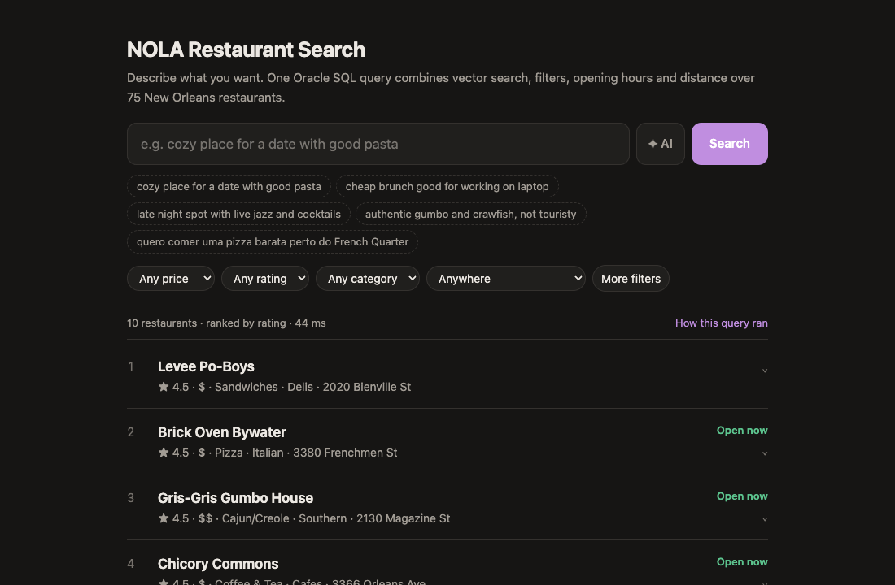
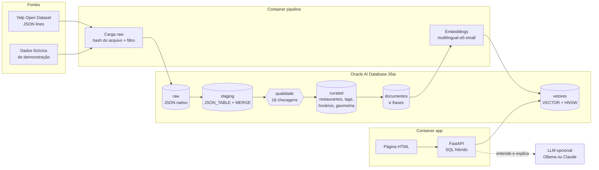
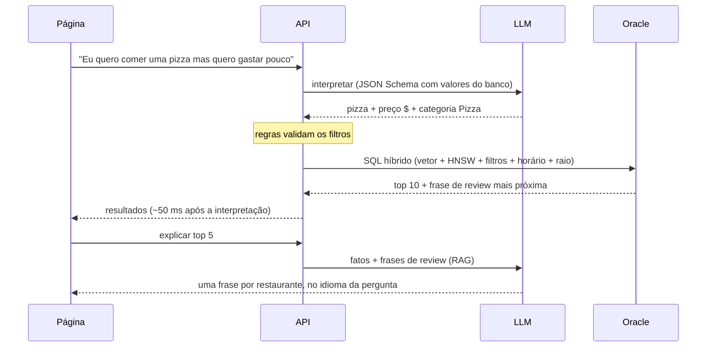

# restaurant-semantic-search

[](https://github.com/brayanrezend/restaurant-semantic-search/actions/workflows/ci.yml)

Busca semântica de restaurantes em New Orleans com **Oracle AI Database 26ai** como banco vetorial. A pessoa descreve o que quer ("lugar aconchegante para um encontro com boa massa", "brunch barato para trabalhar no notebook") e recebe recomendações vindas de **uma única query SQL** que combina similaridade vetorial, filtros estruturados, horário de funcionamento e distância geográfica. Uma LLM opcional entende a pergunta e explica cada recomendação.



> A demonstração usa um **conjunto de dados fictício** (restaurantes e reviews inventados). O projeto foi construído e avaliado com o [Yelp Open Dataset](https://business.yelp.com/data/resources/open-dataset/), cujos termos não permitem exibir os dados publicamente; veja [Dados](#dados).

## Destaques

- **Pipeline de dados idempotente** raw → staging → qualidade → curated dentro do Oracle, com `JSON_TABLE`, `MERGE`, migrations versionadas e checagens de qualidade com quarentena.
- **Embeddings incrementais**: cada vetor guarda o hash do texto e a revisão do modelo; só é recalculado o que mudou.
- **Busca híbrida em um único SQL**: vetor do restaurante + frases de review (índice **HNSW**) fundidos por Reciprocal Rank Fusion, mais filtros, "aberto agora" e raio geográfico (Oracle Spatial).
- **Avaliação com números**: 30 perguntas com rótulos definidos por regras, nDCG/MRR por variante, comparação de modelos e benchmark HNSW × busca exata.
- **LLM opcional e verificável**: a IA propõe filtros, regras os validam; as explicações usam só dados do banco (RAG). Toda chamada fica registrada no Oracle.

## Arquitetura



Caminho de uma busca com a IA ligada:



## Stack

- **Oracle AI Database 26ai Free** (Docker): `VECTOR`, índice HNSW, `JSON_TABLE`, Oracle Text, Spatial, `BOOLEAN` nativo
- **Python 3.12**: pipeline, `sentence-transformers` (`intfloat/multilingual-e5-small`, 384 dimensões, CPU), FastAPI
- **LLM opcional**: Ollama local (`qwen2.5:7b`) ou API da Anthropic
- **Docker Compose**: tudo roda em containers, sem Python local

## Pipeline

| Passo | O que faz |
|---|---|
| `migrate` | Migrations versionadas (`V*.sql`, aplicadas uma vez, com checksum) e repetíveis (`R__*.sql`, reaplicadas quando mudam) |
| `load-business` | Carrega o arquivo de negócios como `JSON` nativo em `raw_business`; pula a carga se o hash do arquivo não mudou |
| `stg-business` | Tipa o JSON com `JSON_TABLE` + `MERGE` e normaliza o nome da cidade |
| `load-reviews` | Lê o arquivo de reviews em streaming e guarda só as reviews dos restaurantes do escopo |
| `stg-review` | Tipa as reviews com `JSON_TABLE` + `MERGE` |
| `dq` | Roda 18 checagens de qualidade: `ERROR` vai para quarentena, `WARN`/`INFO` são registrados |
| `curated` | Restaurantes com pelo menos 20 reviews válidas, atributos limpos, categorias, tags e horários |
| `docs` | Monta um documento de texto por restaurante (perfil + reviews mais úteis), com hash |
| `embed` | Gera vetores só para documentos cujo hash ou modelo mudou |
| `passages` | Quebra as reviews de cada documento em frases e gera um vetor por frase (índice HNSW) |

Todos os passos são idempotentes: rodar o pipeline duas vezes dá o mesmo resultado. Escopo: New Orleans, categoria `Restaurants`, abertos e com pelo menos 20 reviews.

### Qualidade de dados

Problemas reais encontrados nos dados da Yelp e como são tratados (o conjunto fictício reproduz os mesmos casos):

| Checagem | Severidade | Tratamento |
|---|---|---|
| Nome da cidade com grafias diferentes (`NEW ORLEANS`, `new orleans`) | INFO | Normalizado com `INITCAP(TRIM())` |
| Atributos como literais Python (`u'free'`, `"{'romantic': False}"`) | — | Convertidos em valores limpos e JSON por funções SQL |
| Horários que viram a meia-noite (`18:0-2:0`) | INFO | Tratados na lógica de "aberto agora" |
| Horários ambíguos (`0:0-0:0`) | WARN | Marcados como `AMBIGUOUS`; "aberto agora" responde `UNKNOWN`, nunca `CLOSED` |
| Horário, preço ou endereço ausentes | WARN | Mantidos e sinalizados |
| Reviews com menos de 20 caracteres | ERROR | Quarentena: fora dos documentos e das contagens |

Cada execução fica em `dq_run` / `dq_check` / `dq_result`; a view `v_dq_summary` mostra a última.

## Busca

`GET /api/search` monta um único statement SQL:

- **ranking híbrido**: o vetor do documento do restaurante (busca exata com `VECTOR_DISTANCE`) fundido por Reciprocal Rank Fusion com as frases de review mais próximas (`FETCH APPROX` no índice HNSW);
- **filtros**: preço, nota, categoria, tags de ambiente (romântico, brunch, música ao vivo...) e características (WiFi, área externa...);
- **"aberto agora"** no fuso de New Orleans, tratando horários que viram a meia-noite e horários ambíguos;
- **raio** a partir de um bairro com `SDO_WITHIN_DISTANCE`.

Uma segunda query busca, para cada resultado, a frase de review mais próxima da pergunta, então toda recomendação vem com uma evidência. Latência local com cache aquecido: ~14 ms no SQL híbrido, <1 ms na evidência e ~32 ms para gerar o vetor da pergunta. A página tem a janela "How this query ran" com os tempos, os parâmetros e o SQL exato.

## Assistente de IA (opcional)

A busca funciona sem LLM. Quando há uma disponível, o botão **✦ AI** aparece e adiciona duas etapas:

1. **Entender a pergunta.** A pergunta (em qualquer idioma) vira texto de busca + filtros: *"Eu quero comer uma pizza mas quero gastar pouco"* → `pizza`, `price_max=1`, `category=Pizza`. A LLM responde num JSON Schema cujos valores permitidos vêm do banco, e o resultado passa por duas verificações:
   - todo valor precisa estar nas listas permitidas;
   - filtros arriscados (preço, aberto agora, WiFi, nota, características, tags) precisam de uma palavra-gatilho na pergunta, e a categoria precisa aparecer na pergunta ou na tradução ("burger" em "hamburger" vale, "Bars" para um hambúrguer não). Assim a LLM não consegue inventar "aberto agora", "aceita cachorro" ou um teto de preço para quem disse que aceita gastar mais.

   Perguntas em inglês seguem com o texto original (reescrever perdia nuance); perguntas em português usam a tradução. A página mostra "Understood as …" com botão Undo, e os filtros aparecem nos controles normais.
2. **Explicar os resultados (RAG).** Os 5 primeiros, com seus fatos, horários e as 3 frases de review mais próximas da pergunta, vão para a LLM, que escreve uma frase por restaurante no idioma da pergunta, usando só esses dados. Roda depois da lista aparecer, então a busca continua rápida.

Toda chamada fica em `llm_call` (provedor, modelo, latência, tokens, cache, valores descartados) e as respostas em `llm_cache`.

| Provedor | Configuração | Observação |
|---|---|---|
| Ollama (padrão) | `brew install ollama && ollama pull qwen2.5:7b` | Roda nativo no Mac (GPU); a app acessa por `host.docker.internal:11434` |
| Anthropic | `LLM_PROVIDER=anthropic` e `ANTHROPIC_API_KEY` no `.env` | Padrão `claude-opus-5-5`; outro modelo via `LLM_MODEL` |
| Nenhum | `LLM_PROVIDER=none` | O botão some |

Com `qwen2.5:7b` num Mac M-series: ~1,8 s para entender a pergunta e ~5 s para explicar cinco resultados.

## Avaliação

`make eval` roda 30 perguntas (20 em inglês, 10 em português) de [eval/queries.yaml](eval/queries.yaml) e grava cada execução em `eval_run` / `eval_result`. Os restaurantes esperados de cada pergunta são definidos por **regras sobre dados estruturados e texto das reviews** (busca full-text do Oracle Text, ex.: "tag de música ao vivo e pelo menos 5 reviews citando jazz"), nunca por embeddings, então os rótulos não dependem dos modelos comparados. São rótulos aproximados ("silver"): servem para comparar variantes, não como nota absoluta. Com 30 perguntas, diferenças abaixo de ~0,03 são ruído. Os números abaixo foram medidos localmente com os dados da Yelp.

**Modelos de embedding** (só o vetor do documento):

| Modelo | nDCG@10 | Inglês | Português |
|---|---|---|---|
| e5-small-v2 | 0,560 | 0,677 | 0,238 |
| bge-small-en-v1.5 | 0,547 | 0,678 | 0,189 |
| **multilingual-e5-small** (escolhido) | 0,574 | 0,645 | 0,379 |

**Estratégia de ranking e IA** (multilingual-e5-small):

| Variante | nDCG@10 | MRR | Inglês | Português |
|---|---|---|---|---|
| Vetor do documento | 0,574 | 0,736 | 0,645 | 0,379 |
| Só a melhor frase de review | 0,481 | 0,639 | 0,516 | 0,387 |
| **Híbrida (padrão da app)** | **0,630** | 0,783 | 0,701 | 0,435 |
| Híbrida + texto da IA | 0,664 | 0,829 | 0,701 | 0,564 |
| Híbrida + texto + filtros da IA | 0,807 | 0,898 | 0,755 | 0,949 |

Parte do ganho dos filtros da IA vem de perguntas cujos rótulos usam os mesmos atributos (um filtro correto de "pizza barata" quase garante acertos). Nas perguntas rotuladas só por texto de review os filtros não ajudam, e uma versão anterior que reescrevia perguntas em inglês perdia nuance ("cozy place for a date with good pasta" virava "cozy date") e caía de 0,698 para 0,645 nesse grupo; por isso hoje a IA só traduz.

**Extração de filtros pela IA** (`qwen2.5:7b`): 97% das perguntas totalmente corretas, 0 valores inventados, 1 erro (a tag "música ao vivo" não marcada numa pergunta em português).

**HNSW × busca exata** (`make bench`, frases de review, top 10):

| TARGET ACCURACY | Recall vs exato | Exato p50 | HNSW p50 |
|---|---|---|---|
| 70 | 0,997 | 43,2 ms | 0,9 ms |
| 90 | 1,000 | 43,2 ms | 2,9 ms |
| 99 | 1,000 | 43,2 ms | 2,8 ms |

O plano de execução mostra `VECTOR INDEX HNSW SCAN`. Os documentos de restaurante, bem menos numerosos, ficam na busca exata (~3 ms).

## Como rodar

Requisitos: Docker (~8 GB de memória para o Docker Desktop). Ollama é opcional.

```bash
cp .env.example .env
make build      # imagem da app com torch (CPU) e os modelos de embedding (~2,8 GB)
make up         # Oracle + app; a primeira subida baixa o Oracle (~2,5 GB) e cria o banco (~3 min)
```

**Opção 1: dados de demonstração** (fictícios, já no repositório, ~2 minutos):

```bash
make demo
```

**Opção 2: dados da Yelp** (reais, exigem aceitar os termos da Yelp):

1. Em https://business.yelp.com/data/resources/open-dataset/, aceite os termos e clique em **Download JSON** (4,35 GB).
2. Extraia só os arquivos usados pelo pipeline em `data/raw/`:

   ```bash
   tar -xf yelp_dataset.tar -C data/raw \
     yelp_academic_dataset_business.json \
     yelp_academic_dataset_review.json
   ```
3. Rode `make pipeline` (~10 minutos na primeira vez).

Depois, abra http://localhost:8000. O banco guarda um conjunto por vez; trocar entre `make demo` e `make pipeline` recarrega os dados de forma incremental.

Outros comandos: `make test` (lint + testes unitários, sem banco), `make eval` (qualidade da busca e da IA), `make bench` (benchmark HNSW), `make demo-data` (gera de novo os dados fictícios com a LLM), `make logs`, `make sql` (SQL*Plus como usuário da app), `make down`.

## Dados

- **Yelp Open Dataset**: usado no desenvolvimento e na avaliação. Os termos de uso não permitem redistribuir nem exibir publicamente os dados (principalmente reviews) nem divulgar estatísticas sobre eles, por isso o repositório traz apenas o código e as instruções de download, e a pasta `data/` fica fora do git. Os dados vão até janeiro de 2022.
- **Dados de demonstração** ([demo/](demo/)): 75 restaurantes fictícios, com nomes inventados, coordenadas em bairros reais de New Orleans e reviews escritas por uma LLM a partir de um perfil (culinária, preço, ambiente). Têm o mesmo formato JSON da Yelp, então passam pelo mesmo pipeline. Gerados por `python -m rss.demo`.

## Estrutura do repositório

```
db/startup/      scripts de inicialização do Oracle (memória vetorial, tablespace, usuário), idempotentes
db/migrations/   V*.sql tabelas e índices, R__*.sql funções e views
db/transform/    SQL de staging e curated
db/quality/      checagens de qualidade
demo/            dados fictícios de demonstração
eval/            perguntas de avaliação e regras de relevância
src/rss/         pipeline, busca, assistente de IA, avaliação, API e página
tests/           testes unitários (rodam no CI do GitHub Actions)
```

## Licença

Código sob licença [MIT](LICENSE). Os dados da Yelp seguem os termos da Yelp e não fazem parte do repositório.
